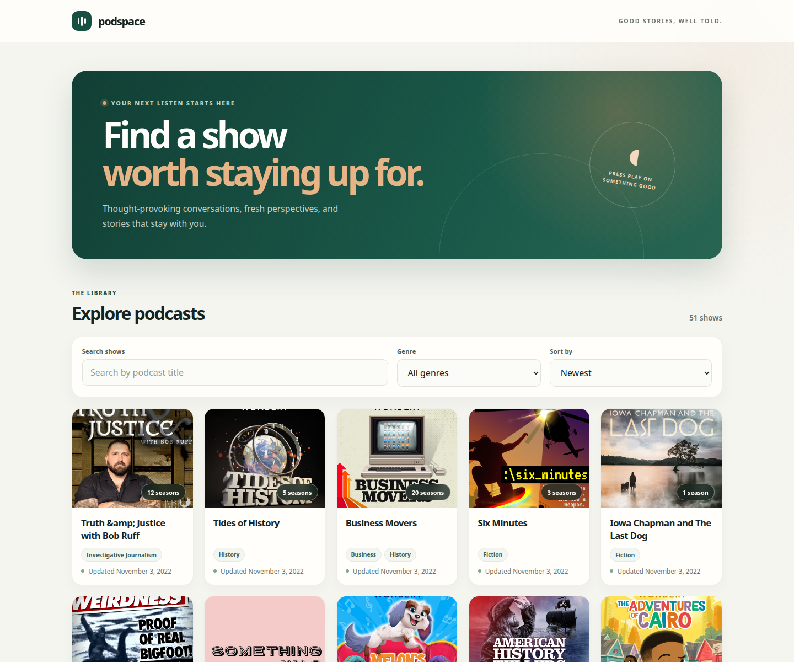

# Podspace

Podspace is a responsive podcast discovery app built with React and Vite. Browse
podcasts, search by title, filter by genre, sort the catalog, and explore show
seasons and episodes.

## Live app

[Open Podspace](https://is.gd/6B5B0z)

## Preview



## Development

```bash
npm ci
npm run dev
```

The app fetches live data from the Podcast API and needs an internet connection.

## Checks and production build

```bash
npm run lint
npm run build
npm run preview
```

The live GitHub Pages site is published from the `gh-pages` branch. GitHub
Actions runners are unavailable while the account has a billing issue.
