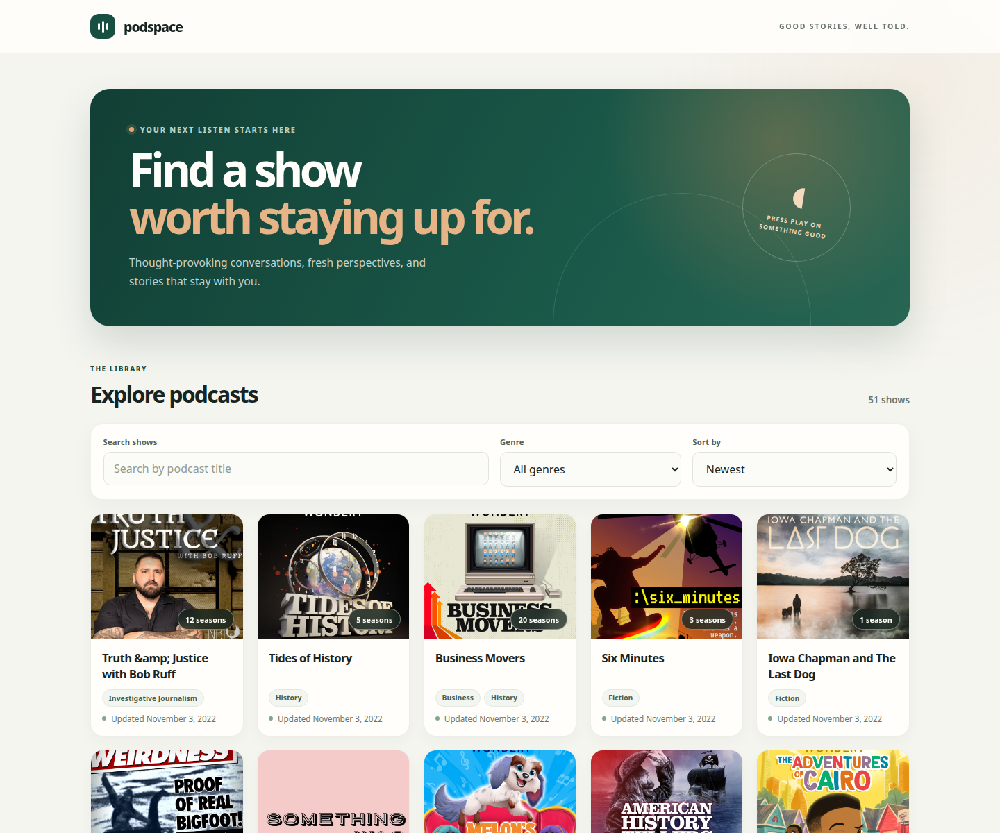

# Podspace

A responsive podcast discovery app for browsing shows, searching by title,
filtering by genre, sorting the catalog, and exploring seasons and episodes.

## Preview



## Live site

[Open Podspace](https://is.gd/6B5B0z)

## Run locally

```bash
cd Podcast-app
npm ci
npm run dev
```

The app uses the Podcast API, so live podcast data requires an internet
connection.

## Production build

```bash
cd Podcast-app
npm ci
npm run lint
npm run build
```

GitHub Pages serves the production build from the `gh-pages` branch. GitHub
Actions could not be used because the account's billing status prevents hosted
workflow runners from starting.
